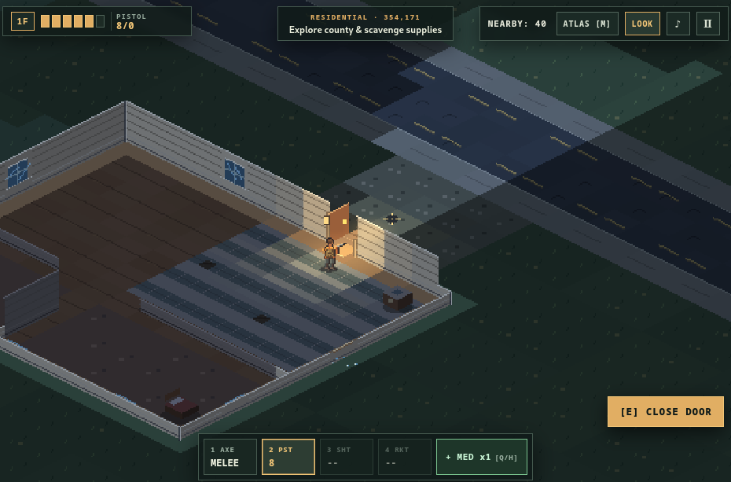

# Zombiebox

This is a wip zombie survival sandbox game for mobile or web browser. The world is procedurally generated.



To play in your browser, clone the repo and do `make run`. Tested on Linux.

To play on Android, run `make build` and copy the APK to your device from `./apps/mobile/zombiebox-android.apk`.

> AI generated info below!

## Run the browser playtest

From the repository root, start the dev server with stable Rust 1.87 or newer. The server needs a working `wgpu` adapter for action play. The browser receives rendered frames over HTTP.

```sh
cargo run --locked -p zombiebox-web
```

Open `http://127.0.0.1:8765` and choose **Enter the county**. Move with **WASD** or the **arrow keys**, hold **Shift** to walk quietly, aim with the mouse, and click or press **Space** to fire. **C** cycles the camera: **Chase** and **First Person** use the mouse to look around relative to mouse movement and fire follows the view, while **Iso**, **Top**, and **Orbit** keep screen-relative aiming. Use **E** to interact, **1–4** to equip a weapon, **R** to reload, **Q** or **H** to heal, **M** for the atlas, and **Escape** to pause. Near a motorcycle, **E** mounts or dismounts; while riding, **A/D** steer, **W/S** throttle and brake (hold **S** at a stop to push backward), **J/L** lean, and **E** dismounts even while rolling. Touch devices have on-screen controls.

The original tile-command playtest is available at `http://127.0.0.1:8765/legacy`. Stand on the marked crate and press **L** to scavenge. **Fire** highlights when the pistol has a clear shot, and **Space** fires.

### Explore a procedural county

Choose **Open County Field Atlas** on the browser opening screen or **County atlas** in the Android app. During play, use **M** in the browser or **Map** on Android. For the reference county, open [seed 42](http://127.0.0.1:8765/county?seed=42) with the browser host running. You can enter any unsigned 64-bit decimal seed on the opening screen or in the atlas.

Select a landmark to inspect its approach, floor plans, supply caches, and baseline infected placements. **Start walk** switches to the atlas walk view. Move with WASD, arrows, or the touch pad. Use the minus and plus buttons on stairs to change floors. Choose **Play at this cell** to start a run at the selected location, or **Teleport here** to move within an active county run. Same-seed teleports keep your gear and world changes for the life of the run.

### Install the Android app

Build a sideloadable release APK from the repository root. This requires Node 22, JDK 17, CMake 3.22.1, Android SDK platform 37, Build Tools 36.0.0 and 37.0.0, NDK 27.1.12297006, and the Rust Android targets. The Gradle release variant uses the local Android debug signing key for sideloading.

```sh
cd apps/mobile
npm ci
rustup target add aarch64-linux-android x86_64-linux-android
cd android
./gradlew :app:assembleRelease
mkdir -p ../build
cp app/build/outputs/apk/release/app-release.apk ../build/zombiebox-android.apk
```

or, from the repository root, use the Makefile shortcuts:

```sh
make build   # same as `make apk`: assembleRelease, copy to apps/mobile/build, print the SHA-256
make install # adb install -r apps/mobile/build/zombiebox-android.apk
make run     # browser playtest: cargo run --release --locked -p zombiebox-web
```
`make` sets `ANDROID_HOME` from the environment, falling back to a local SDK install.

The APK is written to `apps/mobile/build/zombiebox-android.apk`. Its settings menu shows the build stamp (`BUILD <short-commit>`, plus `-dirty` for a modified working tree), generated at build time by `apps/mobile/scripts/write-git-info.cjs`. To install it on a USB-connected Android phone with USB debugging enabled:

```sh
adb install -r apps/mobile/build/zombiebox-android.apk
```

The app runs offline in landscape. Drag the left stick to move (light tilt walks quietly without footstep noise) and use the right stick to aim and fire with your chosen scheme in **Settings** (**Tap Stick** by default: drag to aim, tap to fire, double-tap & hold for continuous fire; **Outer Ring** auto-fire; or **Release** to fire with center-cancel). Use the bottom hotbar to switch between the **Axe**, **Pistol**, **Shotgun**, and **Rocket Launcher**, tap **+ MED** for quick-heal, and tap the contextual interact prompt (or scene near a prompt) to search caches, open/close doors, vault broken windows, drop from 2F windows, or take stairs. Procedural retro SFX, Android haptics, and aim look-ahead are configurable in **Settings**.

To install manually, transfer the APK to the phone and open it from Downloads or a file manager. If prompted, allow that app to install unknown apps, then confirm installation. See the [mobile guide](apps/mobile/README.md) for SDK setup and current emulator verification.

The APK build is a local sideload build signed with the debug key, not a store release. Device testing status is tracked separately from build success.

### Play the browser build on Android

For a phone playtest over Tailscale, connect both devices to the same tailnet and bind the server to the development machine's Tailscale IPv4 address.

```sh
tailnet_ip=$(tailscale ip -4)
cargo run --locked -p zombiebox-web -- --bind "$tailnet_ip:8765"
```

Open `http://<tailscale-ip>:8765` on the phone, substituting the development machine's Tailscale IP. The phone needs access to TCP port 8765. Runs live in server memory and can be restarted from the playtest screen.

## Run the desktop 3D viewer

```sh
cargo run --locked -p zombiebox-render3d --features viewer --example viewer -- --seed 42
```

Add `--birch` for Birch Street. Use **1–5** to switch between isometric, overhead, orbit, chase, and first-person views. The window title displays controls and frame statistics.

## Replay the encounter headlessly

```sh
cargo run --locked -p zombiebox-core --example survival -- 42
```

`42` is the world seed. The example replays the original cache and blast encounter used by the headless tests and prints the results after each command.

## Project structure

| Path | What lives here |
| --- | --- |
| [crates/zombiebox-core](crates/zombiebox-core) | Fixed-tick survival rules, world generation, gameplay events, and the headless example |
| [crates/zombiebox-ffi](crates/zombiebox-ffi) | Versioned C interface for native hosts to own and step a Rust run |
| [crates/zombiebox-render3d](crates/zombiebox-render3d) | Shared 3D camera, chunk meshing, lighting, character animation, combat effects, and GPU presentation |
| [crates/zombiebox-web](crates/zombiebox-web) | Playtest HTTP host for the Rust simulation |
| [apps/mobile](apps/mobile) | React Native Android app, JNI host, and native build guide |
| [apps/web](apps/web) | Streamed action frames, touch controls, HUD, and Canvas atlas and turn-based playtest |
| [docs/product-decisions.md](docs/product-decisions.md) | Product checklist, visual/performance targets, and milestone completion checks |
| [docs/goals.md](docs/goals.md) | Directional guidance for upcoming gameplay, procedural world, vehicle, AI, and audio goals |
| [docs/architecture.md](docs/architecture.md) | Stack decision, runtime ownership, procedural streaming, rendering plan, and device criteria |
| [docs/world-design.md](docs/world-design.md) | Seed-driven procedural county design, plausible district rules, loot/infected ecology, and vehicles |
| [docs/motorcycle-plan.md](docs/motorcycle-plan.md) | Motorcycle gameplay, shared vehicle types, and implementation handoff |
| [docs/living-buildings-plan.md](docs/living-buildings-plan.md) | Realistic multi-floor buildings, interior furnishing, signage, themed zombies, and extensible compounds |
| [docs/world-and-town-layout-plan.md](docs/world-and-town-layout-plan.md) | Organic town morphologies, freeways/roadside stops, and scaling to a practically-infinite world |

## Run the checks

```sh
cargo test --locked --workspace
cargo clippy --locked --workspace --all-targets -- -D warnings
cargo clippy --locked -p zombiebox-render3d --features viewer --all-targets -- -D warnings
cargo fmt --all -- --check
sh scripts/check-native.sh
```

The C ABI smoke check requires a Unix host and a C compiler. The GPU presentation captures and migration checks are listed in the [3D progress ledger](docs/render3d-progress.md). See the [mobile development guide](apps/mobile/README.md) for Android setup, APK build and sideload instructions, play controls, and the future iOS port.
