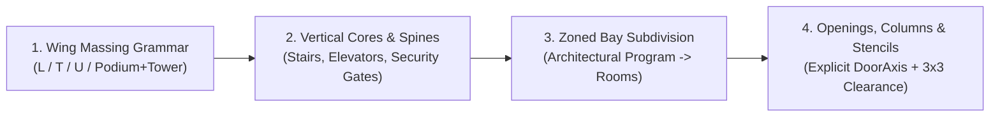

# Procedural building, floorplan, and compound generation algorithms

Technical architecture accompanying [living-buildings-plan.md](living-buildings-plan.md). Grounded in `zombiebox-core` (`world/{geography,parcels,sites,relief}.rs`, `action/{county,block,types}.rs`, `spatial/`) and `zombiebox-render3d` (`mesh/buildings.rs`, `scene/`, `gpu/visibility.rs`).

---

## 1. Current codebase bottlenecks & root causes

### 1.1 Fixed 3-floor ceiling (`COUNTY_FLOORS = 3`)
- **Chunk & window storage (`crates/zombiebox-core/src/action/types.rs`, `county.rs`):** `COUNTY_FLOORS: usize = 3` sizes `CountyChunk::cells: [[[Cell; 16]; 16]; 3]` (`~15.4 KB/chunk` even in empty forest chunks) and `WINDOW_CELLS = 112 * 112 * 3`.
- **Collapse & lighting assumptions (`county.rs`):** `collapse_stack_from` hardcodes `if from_fl == 1 { let f2 = Tile3D::new(wx, wy, 2); ... }` rather than iterating `from_fl + 1 .. max_floors`, and outdoor streetlight bleed only checks `fl == 1`.
- **Renderer snapshot (`zombiebox-render3d/src/scene/snapshot.rs`, `gpu/visibility.rs`):** `MAX_SNAPSHOT_FLOORS = 3` sizes `TileSnapshot` and `VisibilityTexture` (`256 × 1024`). Fortunately, `VertexMeta::floor` is already an 8-bit `u8` (`0..=254`, `255` exterior) and `survey.rs` already iterates `1..b.floors` dynamically.

### 1.2 Rectangular single-AABB assumptions, `ArmySub`, roofs & cutaways
- **Single-box metadata (`BuildingInfo`, `BuildingReg::ArmySub`):** `BuildingInfo` assumes one rectangle `(x, y, width, height)` with uniform `floors` and one `foundation_z`. Multi-building army bases rely on a hardcoded 3-box `BuildingReg::ArmySub([ArmySubBox; 3])` special case in `county.rs`.
- **Missing roofs on stepped wings (`mesh/buildings.rs`):** Roof geometry is emitted only when `f + 1 == info.floors`. A 2-story house with a 1-story garage/porch, or a 5-story hospital with a 2-story ER podium, leaves lower wings roofless to the sky. Pitched gable math also measures distance from the global AABB rather than wing bounds, warping L/T/U roofs.
- **Premature courtyard cutaway (`scene/mod.rs`):** `building_wants_cutaway` checks the outer `[x, x + width] × [y, y + height]` AABB, dissolving an entire U-shaped hospital or L-shaped house while the survivor is still outside in its recessed courtyard.
- **Single pad per parcel (`parcels.rs`, `relief.rs`):** Each `Parcel` flattens at most one rectangular `PlannedPad`, preventing compounds on rolling Seattle-style terrain from terracing individual structures to local ground height.

### 1.3 `sites.rs` 4-quadrant template & metadata-free `Feature`
- `sites.rs::floorplan` divides every rectangle with a single cross-hallway `(midx, midy)` into at most four rooms, puts one fixed stair at `(min.x + 1, min.y + 1)`, drops one `Feature::Furniture` in each corner, and carves a rear recess *after* placing walls and doors.
- `Feature` lacks wall/door axis, door security/type, stair direction, prop ID, floor surface, and ceiling/roof flags — forcing `CountyStage::materialize_chunk` to guess orientation and surfaces from neighbor heuristics.

### 1.4 Exact root causes of blocked generated doorways (`product-decisions.md`)
Three bugs combine to block the `r = 0.23m` (`0.46m` diameter) survivor at open generated doors:
1. **90°-rotated doors at T-junctions:** `wall_orientation` sets `(true, true) => WallOrientation::Corner` when a door touches walls on both axes, and both `action_adapter.rs` and `buildings.rs` evaluate `let along_y = cell.orientation == WallOrientation::AlongY`, treating `Corner` as `AlongX`. Any door in an `AlongY` wall adjacent to a perpendicular partition rotates 90° across its own threshold!
2. **Perpendicular wall edge intruding into threshold:** Duplex secondary front doors and post-hoc recess walls can place a perpendicular wall directly behind a door tile `(door + normal)`, narrowing clearance to `0.45 - 0.08 = 0.37m < 0.46m`.
3. **Top-left corner-hugging `connect_floor`:** `connect_floor` scans `(y, x)` from `(min.y + 1, min.x + 1)` and punches a door at the *first* partition tile — systematically hugging wall corners while unit tests check only 4-neighbor tile centers instead of swept `0.23m` capsule clearance.

---

## 2. Recommended hybrid generation pipeline

### Why a 4-stage hybrid beats pure BSP, organic growth, or WFC

| Candidate | Strengths | Weaknesses in Zombiebox | Role in plan |
| --- | --- | --- | --- |
| **Pure Guillotine / Treemap BSP** | Fast, clean rectangular rooms. | Creates walk-through bedrooms/cells; blind to public-to-secure gradients and open-span retail floors. | Used **inside bays** after spine & security zoning. |
| **Pure Organic Room Accretion** | Varied house silhouettes. | Misaligned upper walls break stair/elevator shafts and `count_load_bearing_3x3` collapse support. | Replaced by **Wing Massing Grammar**. |
| **Tile Wave Function Collapse** | Rich micro-patterns. | Slow/backtracking on `32×32×6` grids; poor global guarantees (e.g., "one lobby gating cells + armory"). | Avoided for macro architecture. |
| **Wing Massing + Spine/Core Skeleton + Security-Zoned Subdivision + Stencil Solver** | Deterministic `O(area)`, zero backtracking, enforces load-bearing alignment, security zones, open-span columns, and doorway clearance. | Needs explicit `BuildingArchetypeDef` data specs (which directly enables modding). | **Adopted pipeline** |

### Deterministic stage pipeline (`mix64(world_seed ^ parcel_id ^ stage_salt)`)



1. **Stage 1 — Wing Massing (`FootprintPlan`):** Operate in lot-local `(u, v)` coordinates (`+v` away from street frontage `lot.front`) to emit `wings: Vec<WingVolume>` (`MainBar`, `AttachEll`, `AttachSymmetricWings` for U/T/H courts, `PodiumAndTower` for stepped upper floors, `AttachPorch`/`Canopy`). Upper-floor setbacks automatically promote aligned lower-floor walls or `TileKind::Pillar` lines to `load_bearing = true` so structural overhang collapse stays physically sound.
2. **Stage 2 — Vertical Cores & Circulation Spines:** Intersect `0..max_floors` footprints to stamp aligned **Stairwells** (`1×3` or `2×2` switchbacks with guaranteed clear landings) and **Elevator Banks** (`max_floors >= 3`), plus a remote **Fire Stairwell** on large footprints (`>= 18` tiles). Carve `2`-tile primary corridors (`1–2` in houses) from Front Entry $\rightarrow$ Lobby $\rightarrow$ Vertical Cores $\rightarrow$ Wing Spines $\rightarrow$ Fire Exits, placing **Security Gateways** where security level rises.
3. **Stage 3 — Security-Zoned Bay Subdivision:** Tag non-spine bays by exposure (`FrontFacade`, `SideExterior`, `RearService`, `WindowlessCore`) and split bays with constrained Guillotine/Strip Treemap according to the archetype's `RoomRequirementDef` list (`min_dim >= 3` tiles for rooms; `>= 2` for stalls/closets).
4. **Stage 4 — Explicit `BlueprintCell` & Doorway Clearance Invariant:**
   - Emit rich `BlueprintCell` records carrying explicit `DoorAxis::{AlongX, AlongY}`, `Surface`, `TileKind`, `Material`, `stair_dir`, `has_roof_above`, and `load_bearing`.
   - **Hard `3×3` Doorway Stencil:** Every door at `p` with wall tangent `t` and passage normal `n` requires co-linear wall/pillar anchors at `p ± t` and open, barrier-free, prop-free walkable floor at `p ± n`. Perpendicular T-junction walls may join only at `p ± k*t` (`k >= 1`), never at `p` or `p ± n`. Score candidate wall segments to place doors near **segment midpoints**, verified by a swept `r = 0.23m` capsule test.

---

## 3. Concrete building archetype algorithms

### 3.1 Police station (`2–3F`, `Zone 0 -> Zone 3` security topology)
- **Zone 0 (Public):** Sole unlocked front entrance $\rightarrow$ **Lobby** (waiting benches, readable bulletin board, **Public Restrooms** accessible without passing security).
- **Zone 0 $\rightarrow$ 1 Barrier:** `BrickMasonry` + ballistic `Window` **Booking Counter** + single locked security `Door` (`KeyTag::PoliceStaff` or breachable).
- **Zone 1 (Secured Staff):** **Office Bullpen** (`2×2` desk pods, readable incident logs & keycard spawn candidates), Captain's Office, Staff Locker/Bath, **Interrogation + Viewing Room** (paired rooms sharing an interior one-way `Window` wall, entered separately from staff corridor), and enclosed rear **Sallyport / Garage** facing a fenced driveway (`Gate` to street).
- **Zone 2 (Detention):** Spur corridor gated by a locked barred door (`KeyTag::CellBlock` or breachable) $\rightarrow$ row of `3×3` **Holding Cells** (`Material::MetalPole` barred front walls & doors, bunk, steel toilet). **Zero exterior doors and zero F0 windows.**
- **Zone 3 (Armory & Evidence):** Interior **windowless core** room (`BrickMasonry`, reinforced steel `Door` requiring `KeyTag::PoliceArmory` looted from Captain/Officer zombie or desk, or heavy explosive breach — immune to light melee/pistol), stocked with firearm/ammo lockers.

### 3.2 Hospital (`4–6F`, `PodiumAndTower` massing)
- **F0 (Emergency & Lobby Podium):** Public main entrance $\rightarrow$ **Lobby / Waiting**, reception, readable floor directory, **Public Restrooms**, **Central Elevator Bank (2 cars)** + Main Stairs. Side covered **Ambulance Canopy** $\rightarrow$ double doors $\rightarrow$ **ER Trauma Bays** + Triage. Rear wing holds Radiology, Morgue/Pathology, Supply Dock, and **Fire Stairwell #2**.
- **F1 (Diagnostics & Pharmacy — Podium Top):** Locked **Pharmacy** (dispense window + medkit vault gated by `KeyTag::HospitalPharmacy` on pharmacist/doctor zombies/desks or physical door breach), **Clinical Labs**, Exam Rooms, Cafeteria, Restrooms, and access to `F2` mechanical roof terrace.
- **F2–F3 (Inpatient Wards — Stepped Tower):** Central **Nurses' Station** island with 360° corridor sightlines, perimeter windowed **Patient Rooms / Wards**, Medication Closet, Bathrooms.
- **F4+ (Surgery, ICU & Helipad Roof):** `5×5` sterile **Operating Rooms** (central surgical table, overhead surgical light, adjacent **Scrub/Prep** rooms), glass-fronted **ICU** bays, Mechanical Room, and penthouse stair/elevator access to flat **Tower Roof** (optional `H` helipad + supply cache).

### 3.3 Grocery store / supermarket (`1–2F`, open-span column grid)
- **Open-span structure:** `70%` of `F0` is one continuous `SupermarketFloor` supported by a `(6, 6)` grid of load-bearing `TileKind::Pillar` (`Material::MetalPole`) columns instead of drywall rooms.
- **Interior zoning:** Front corner **Entrance Vestibule** $\rightarrow$ parallel **Checkout Lanes** near exit $\rightarrow$ `3–5` parallel runs of `HighBlocker` **Gondola Shelves** separated by `2`-tile aisles and front/back cross-aisles ("action alleys" with endcap loot) $\rightarrow$ perimeter **Glass Freezers** & Deli Counter $\rightarrow$ full-width back wall with two double-doors into **Stockroom**, **Loading Bay**, **Restrooms**, and optional `F1` Manager Mezzanine.

### 3.4 Residential houses (`1–2F`, 5 seeded sub-archetypes)
Selected from `(lot_size, corner_lot, seed)` so neighboring houses vary in footprint, roof, and yard:
1. **Craftsman Bungalow (`1F`):** Full-width front porch (`Pillar` posts + porch light) $\rightarrow$ Living $\rightarrow$ Kitchen/Dining $\rightarrow$ Bath + 2 Bedrooms $\rightarrow$ back stoop.
2. **Suburban Ranch (`1F`, `L-Wing`):** Protruding attached **Garage** aligned to street driveway $\rightarrow$ Kitchen $\rightarrow$ Living $\rightarrow$ bedroom hall (2–3 Bedrooms + Bath) $\rightarrow$ rear patio glass door.
3. **Center-Hall Colonial (`2F`):** Central foyer + stairs $\rightarrow$ Living (left) & Kitchen/Dining + Half-Bath (right); `2F` landing $\rightarrow$ Master Suite + 2 Bedrooms + Full Bath.
4. **Split-Level (`1F + 2F` stepped wings):** `1F` garage/den wing paired with `2F` main block using per-cell roof emission.
5. **Side-by-Side Duplex (`2F`):** Load-bearing `BrickMasonry` party wall dividing two complete units with independent porches, front/back doors (`>= 2` tiles clear of party wall), kitchens, stairs, and upstairs bedrooms/baths.

---

## 4. Sparse multi-floor scaling (`MAX_COUNTY_FLOORS = 8`) & elevators

### 4.1 Sparse floor storage & stepped wing roofs
- **Sparse `CountyChunk` floors:** Replace fixed `[[[Cell; 16]; 16]; 3]` (`15.4 KB/chunk`) with `SmallVec<[Box<[[Cell; 16]; 16]>; 2]>` capped at `MAX_COUNTY_FLOORS = 8`. Open country/woods chunks allocate **1 layer (`5.1 KB`)**, suburbs allocate **1–2 layers (`5–10 KB`)**, and only hospital/downtown tower chunks allocate **4–8 layers (`20–41 KB`)** — cutting county baseline chunk memory by **~60%** while unlocking 8-story buildings.
- **Window & GPU visibility scaling:** Track `window_max_floors: u8` across active `7×7` chunks so `ensure_window_rooms` and `ensure_static_light` iterate only `0..window_max_floors`. Expand `VisibilityTexture` to `256 × (256 + 8 * 256) = 256 × 2304` (`589 KB` `R8Uint`, well inside mobile Vulkan/WebGL2 `4096+` limits). Generalize `collapse_stack_from` to loop `(from_fl + 1)..chunk_floors`.
- **Stepped roofs & per-wing cutaways:** Emit roof geometry + roof collider at `(p, f)` whenever `(p, f)` is indoor/covered and `(p, f + 1)` is `Air`/absent, tagging roof vertices with `floor = f + 1` so `floor_index > active_floor` dissolves podium roofs on `F0/F1` and keeps them solid underfoot/below eye level when on `F2+`. Test `building_wants_cutaway` against **occupied wing rects / `building_id` cells** instead of the outer bounding box.

### 4.2 Elevators, HUD floor button strip & acoustic survival gameplay
- **Representation:** `TileKind::ElevatorShaft` aligned vertically across `min_floor..=max_floor`, `TileKind::ElevatorDoor { open }` facing a `2`-tile lobby on each floor, and dynamic `ElevatorCar` state in `CountyStage` (`z`, `current_floor`, `target_floor`, `door_timer`, `powered`).
- **HUD Floor Button Strip (`1F..NF`):** Outside a shaft, `Interact` triggers `CallElevator`. Once standing on a powered `SupportId::ElevatorCar`, the HUD exposes a compact **floor button strip (`1F..NF`)** (highlighting `current_floor` and `target_floor`) so the player can tap any served floor directly.
- **Physics:** `SupportId::ElevatorCar(ElevatorId)` translates grounded actors smoothly at `~2.0 m/s` (`~42` ticks/floor), with a walkable car roof at `car.z + WALL_HEIGHT`.
- **Acoustic hook:** Arriving at `target_floor` fires `ActionEvent::ElevatorArrived` and `NoiseEvent { kind: NoiseKind::ElevatorBell, radius: 14.0 }`, drawing infected on that floor toward the elevator lobby during the `0.8s` door-open beat. Unpowered elevator doors can be pried/chopped open with the Axe to drop onto a car below, climb an emergency shaft `Ladder`, or lure chasers down the shaft.

---

## 5. Extensibility & moddability (new buildings + whole new areas)

### 5.1 Unifying single buildings and multi-structure compounds via `ParcelPlan`
- Eliminate `BuildingReg::ArmySub` (and retire the placeholder `ArmyBase` from county generation until tanks and planes land) by having every parcel resolve a `ParcelPlan` with `structures: Vec<PlacedStructure>` (each getting its own `PlannedPad`, terraced `foundation_z` from `relief.rs`, `BuildingId`, `floors`, `RoofStyleDef`, and wing rects) plus an `OutdoorLayer` (paths, perimeter fences/gates, lights, and multi-tile `SetpieceInstance`s).
- A suburban house with a detached shed is a 2-structure `ParcelPlan`; a shopping plaza is a 3-structure compound; a future **Traveling Circus** (or full military airbase once tanks/planes arrive) is an 8–12 structure + setpiece compound — `CountyStage` materializes all of them through one uniform code path.

### 5.2 Declarative schemas + pluggable strategy registry
```rust
#[derive(Clone, Debug, Serialize, Deserialize)]
pub struct AreaArchetypeDef {
    pub id: String,                       // e.g. "circus_fairground"
    pub display_name: String,             // "Traveling Circus"
    pub siting: SitingConstraint,         // RuralArterialClearing { min_size: (48, 48), max_slope: 0.08 }
    pub compound_planner: String,         // "radial_midway" | "fenced_perimeter" | "single_lot"
    pub structures: Vec<CompoundSlotDef>, // Ticket booths, game stalls, Big Top, trailers, cages
    pub setpieces: Vec<SetpieceSlotDef>,  // FerrisWheel, Carousel, Helipad, RadioTower
    pub ecology: EcologyProfileDef,
}

#[derive(Clone, Debug, Serialize, Deserialize)]
pub struct BuildingArchetypeDef {
    pub id: String,                       // "police_precinct" | "hospital_main" | "circus_big_top"
    pub footprint_grammar: FootprintGrammarDef,
    pub floor_range: (u8, u8),
    pub layout_generator: String,         // "zoned_spine_bsp" | "open_span_aisles" | "arena_ring"
    pub roof_style: RoofStyleDef,         // FlatParapet | PitchedGable | Stepped | ConicalTent
    pub max_public_entries: u8,
    pub vertical_cores: VerticalCoreSpec,
    pub program: Vec<RoomRequirementDef>,
}
```
- **Worked example — Traveling Circus:** One `circus_fairground.ron` spec + `"radial_midway"` compound planner sites a `48×48` clearing along a rural arterial road with twin ticket booths, midway game stalls (toy/household + shooting-gallery ammo caches), performer trailers, `MetalPole` animal cages, a `22×22` octagonal **Big Top Tent** (`Material::Canvas` walls slashable with an axe to escape ambushes + Bayer-dissolving `ConicalTent` roof), and a `16m`-tall **Ferris Wheel** `SetpieceInstance` visible across the valley.
