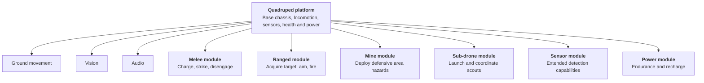
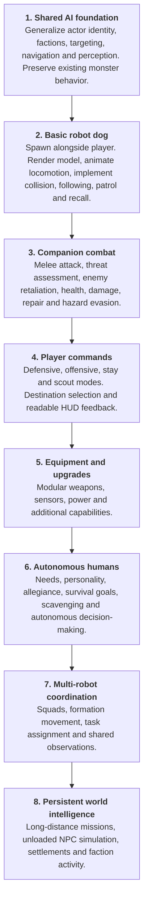

# Zombiebox — NPC intelligence and companion system

I would build this as a general-purpose, faction-aware NPC intelligence system, with the robot dog being its first controllable agent. Rather than implementing companion AI, human AI, zombie AI and swarm AI independently, they should share a common foundation while exhibiting fundamentally different behaviors.

The long-term goal should be a world inhabited by autonomous agents, rather than a world in which every NPC's behavior revolves around the player.

For example:

- Zombies hunt, investigate disturbances and migrate through the environment.
- Robot companions protect their owner, execute orders and coordinate with other robots.
- Human survivors scavenge, seek shelter, form alliances and pursue personal objectives.
- Hostile humans ambush, retreat, flank and defend territory.
- Autonomous robots patrol areas and carry out missions, potentially independently of the player.

These behaviors can emerge from the same underlying systems with different capabilities, motivations, perceptions and decision-making policies.

## 1. High-level AI architecture

I'd recommend a hybrid of utility AI, hierarchical state machines, pathfinding and local steering behaviors. This should offer considerable behavioral complexity without being computationally expensive on moderate Android hardware.

Each layer has a distinct responsibility:

| System | Responsibility |
|---|---|
| Perception | Detect entities, sounds, obstacles and hazards |
| Memory | Remember locations, threats and previous observations |
| Motivation | Represent orders, instincts, needs and priorities |
| Decision-making | Select the most appropriate objective |
| Action execution | Carry out attacks, investigations, repairs, movement, etc. |
| Navigation | Find traversable paths through the environment |
| Steering | Move naturally and avoid nearby obstacles and agents |
| Coordination | Exchange information and distribute tasks between agents |

A zombie and an advanced robot could use the same perception, navigation and combat infrastructure while having entirely different intelligence.

## 2. What we can reuse from Zombiebox today

I reviewed the current main branch. There is already a substantial foundation for this.

| Existing functionality | Reusability |
|---|---|
| 3D A* pathfinding | High |
| Stair traversal and elevation | High |
| Terrain and obstacle collision | High |
| Line-of-sight detection | High |
| Sound propagation | High |
| Local separation steering | High |
| Attack windup and recovery | High |
| Damage and knockback | High, with refactoring |
| Monster awareness state machine | Partial |
| Target selection | Needs generalization |
| Projectile ownership | Needs generalization |
| Chunk streaming and NPC persistence | Partial |

The main architectural limitation is that much of the existing AI assumes there are only two sides: the player and monsters.

For example, `Projectile` currently contains `owner_is_player: bool`, and `step_monsters_3d()` explicitly receives the player's position, body, health and knockback.

I would gradually generalize these systems rather than rewrite them.

Relevant existing code:

- `action/ai.rs` — perception, pathfinding, movement, combat AI.
- `action/mod.rs` — simulation loop.
- `action/weapons.rs` — combat and projectiles.
- `action/county.rs` — world streaming and monster hibernation.

## 3. Robot dog

12

I'd like the dog to feel like an intelligent, independent companion rather than a moving turret attached to the player.

### Operating modes

#### Defensive

Patrol near the player. Intercept incoming threats, protect the player and return after combat.

Suggested radius: 5–8 world units

#### Offensive

Actively search nearby territory for hostile entities. Pursue, engage and search for additional targets until recalled or outside its leash.

Suggested radius: 15–20 world units

#### Stay

Remain at a designated position regardless of player movement. Defend itself locally but do not pursue retreating enemies.

Suggested radius: 1–2 world units

#### Scout

Navigate to a selected location, investigate the surrounding area, detect threats and report discoveries. Hold there or return when complete.

Destination-based rather than player-relative

Player

Robot

Hostile

I'd also add a **Recall** command. Regardless of its current activity, the dog should abandon its objective as soon as safely possible and return to the player.

### Modes should be policies, not states

This is an important distinction.

Defensive mode is an operating policy. Attacking, following, avoiding hazards and investigating noises are individual behaviors.

```rust
pub enum OperatingMode {
    Defensive,
    Offensive,
    Stay,
    Scout,
}

pub enum Behavior {
    Idle,
    Follow,
    Patrol,
    Investigate,
    Intercept,
    Pursue,
    Attack,
    Evade,
    Return,
    MoveTo,
    Recharge,
}
```

A dog in defensive mode might go through eight different behaviors over the course of a minute without ever leaving defensive mode.

This avoids creating an enormous state machine as we introduce more capabilities.

## 4. Making the dog move realistically

### Dynamic following and patrolling

I wouldn't have the dog continuously move toward the player's exact position. That would look robotic in the wrong way.

Instead, maintain three distances:

| Distance | Behavior |
|---|---|
| Under 2 units | Give player space |
| 2–5 units | Comfortable following and patrolling |
| 5–8 units | Increase priority of returning |
| Beyond 8 units | Return to player in defensive mode |

When the player is walking, the dog can choose a position relative to their predicted movement.

When the player is stationary, the dog can select interesting nearby patrol destinations.

Each candidate patrol destination could receive a score based on:

- Distance from the preferred patrol radius.
- Visibility of the surrounding area.
- Time since the location was last visited.
- Proximity to known threats.
- Distance from obstacles and other friendlies.
- Estimated path cost.

Choose a destination every few seconds, with a seeded random component for variety.

### Local steering

A* should determine the route, but local steering should determine how the dog moves along it.

Useful steering behaviors include:

| Algorithm | Purpose |
|---|---|
| Seek | Move toward destination |
| Arrive | Decelerate smoothly near destination |
| Pursuit | Chase a moving entity |
| Separation | Avoid crowding player and allies |
| Obstacle avoidance | Avoid immediate collisions |
| Wander | Produce natural patrol movement |
| Evasion | Escape enemies and hazardous areas |

Combine these with acceleration limits and turn-speed limits. The dog should not instantly reverse direction or turn 180 degrees in a single frame.

Zombiebox already implements kinematic movement and separation for monsters, so some of this work can be extracted directly.

### Motorcycles

Given the existing motorcycle system, this will become important quite quickly.

I would give the dog a traversal policy with three options eventually: follow on foot at sustainable speed, board a compatible vehicle, or travel independently to a rendezvous point.

For the first version, let it sprint after the player up to its maximum speed. If it falls too far behind, preserve its position and indicate that it is separated rather than silently teleporting it.

## 5. Perception and threat assessment

This is particularly important for defensive mode. The dog shouldn't attack every zombie that happens to be within its radius.

It should assess whether a zombie is actually a threat.

Useful information includes enemy velocity, facing direction, distance, recent attacks, weapon range, line of sight and proximity to the player.

### Threat prediction

For a simple initial approach, calculate the closest predicted distance between an enemy and the protected entity over the next few seconds.

If an enemy's relative position is $r$ and relative velocity is $v$:

$$
t_{\mathrm{closest}}=\operatorname{clamp}
\left(\frac{-r\cdot v}{v\cdot v},0,T\right)
$$

$$
d_{\mathrm{closest}}=\|r+vt_{\mathrm{closest}}\|
$$

Handle near-zero relative velocity separately.

A zombie walking toward the player receives a higher threat score than one walking away. Path connectivity, attack telegraphs and weapon capabilities further refine that score.

### Interactive threat assessment prototype

| Field | Value |
|---|---|
| Enemy distance | 7 units |
| Enemy movement | 2 u/s approaching |
| Facing options | Away · Still · Toward |
| Threat score | 50/100 |
| Defensive response | Monitor / investigate |

- [ ] Enemy is preparing an attack
- [x] Clear line of sight

*Illustrative scoring function. We would tune the weights through playtesting.*

Eventually, hostile shooters could use the same threat assessment system to determine which friendly entity represents the greatest danger.

### Memory

NPCs should not be omniscient. They should maintain a limited memory of what they have observed.

```rust
pub struct EntityObservation {
    pub entity: ActorId,
    pub last_known_position: Vec3,
    pub last_known_velocity: Vec3,
    pub last_seen_tick: u64,
    pub confidence: f32,
    pub source: ObservationSource,
}

pub enum ObservationSource {
    Visual,
    Acoustic,
    Damage,
    SharedIntel,
}
```

Confidence should decay over time. If an enemy disappears behind a building, the NPC should investigate its last known position rather than magically track it through walls.

This also provides a foundation for robot-to-robot information sharing.

## 6. Decision-making using utility AI

A traditional finite state machine becomes increasingly difficult to manage as you add intelligence.

Utility AI instead assigns a numerical score to each possible behavior and selects the highest-scoring eligible behavior.

For example, a robot dog in defensive mode might evaluate:

*Scenario: enemy approaching player, dog moderately damaged*

| Behavior | Utility |
|---|---|
| Intercept threat | 92 |
| Evade danger | 63 |
| Return to player | 48 |
| Follow player | 35 |
| Investigate noise | 21 |
| Patrol | 15 |
| Idle | 5 |

Highest eligible score wins, subject to commitment and interruption rules.

The generic interface could look something like:

```rust
pub trait BehaviorPolicy {
    fn evaluate(
        &self,
        ctx: &DecisionContext,
        candidates: &mut Vec<ScoredBehavior>,
    );
}

pub struct ScoredBehavior {
    pub behavior: Behavior,
    pub target: Option<ActorId>,
    pub destination: Option<Vec3>,
    pub utility: f32,
}
```

The evaluation function considers the operating mode, sensor observations, health, capabilities, current orders, environmental conditions and personality.

Some important implementation details:

- **Hysteresis:** a new behavior needs to score significantly higher than the current behavior before switching.
- **Commitment:** finish a melee attack windup unless interrupted by a sufficiently important event.
- **Hard constraints:** don't attack allies, use unavailable weapons or traverse impossible terrain.
- **Emergency overrides:** escape an imminent Bloater explosion, for example.
- **Failure memory:** temporarily deprioritize unreachable destinations.

Without these mechanisms, utility AI can produce rapid oscillation between competing behaviors.

## 7. Extensible capabilities and equipment

Rather than baking combat abilities directly into a robot-dog class, give agents modular capabilities.



Each capability defines which actions it enables and their requirements.

```rust
pub struct CapabilitySpec {
    pub kind: CapabilityKind,
    pub effective_range: f32,
    pub cooldown_ticks: u32,
    pub energy_cost: f32,
    pub requires_line_of_sight: bool,
}
```

The decision system discovers available actions based on installed capabilities.

A human with a pistol, a zombie with a melee attack and a robot with a ranged module can all use the same underlying attack-selection and damage-resolution infrastructure.

### Possible upgrades

| Upgrade | Gameplay effect |
|---|---|
| Reinforced chassis | Increased durability |
| Improved actuators | Faster movement and turning |
| Battery expansion | Longer autonomous missions |
| Thermal sensors | Improved nighttime detection |
| Acoustic array | Better sound localization |
| Communications relay | Greater robot coordination range |
| Self-repair module | Limited autonomous recovery |
| Cargo attachment | Carry supplies |
| Mapping module | Reveal unexplored areas |
| Drone docking bay | Deploy subordinate scout drones |

I would also make upgrades visually apparent on the 3D model.

## 8. Humans with their own agendas

The same architecture becomes particularly interesting when orders are no longer absolute.

A robot dog could have high obedience and loyalty to its owner. A human survivor may have objectives that conflict with the player's.

```rust
pub struct MotivationProfile {
    pub self_preservation: f32,
    pub aggression: f32,
    pub curiosity: f32,
    pub loyalty: f32,
    pub obedience: f32,
    pub sociability: f32,
}

pub struct Needs {
    pub health: f32,
    pub hunger: f32,
    pub fatigue: f32,
    pub fear: f32,
    pub energy: f32,
}
```

These should be optional or profile-specific. A zombie does not need a hunger simulation identical to a human's, and a robot does not need fear or fatigue.

An illustrative comparison:

| Motivation | Robot dog | Survivor | Zombie |
|---|---|---|---|
| Obedience | 100% | 45% | 0% |
| Aggression | 55% | 30% | 95% |
| Self-preservation | 65% | 90% | 5% |
| Curiosity | 60% | 55% | 25% |
| Loyalty to player | 100% | 40% | 0% |

*Example personality profiles, not fixed gameplay values.*

For human NPCs, I'd eventually introduce hierarchical goals and Goal-Oriented Action Planning (GOAP).

For example, a hungry survivor could reason over available actions. The agent selects an achievable sequence of actions according to its needs, available resources and perceived risk.

If the player asks that survivor to help fight a horde, the survivor evaluates the request against its own hunger, fear, loyalty and survival prospects.

This could eventually result in humans who refuse commands, abandon the player, negotiate for supplies, establish settlements, recruit other survivors or change allegiance.

I wouldn't implement GOAP yet, but the architecture should leave room for it.

## 9. Factions and relationships

Friendly versus enemy should be a relationship, not an intrinsic entity type.

```rust
pub enum ActorId {
    Player,
    Monster(MonsterId),
    Npc(NpcId),
}

pub enum Disposition {
    Allied,
    Friendly,
    Neutral,
    Suspicious,
    Hostile,
}
```

Initially, a faction relationship matrix is sufficient.

| Faction | Player | Player robots | Survivors | Infected | Rogue robots |
|---|---|---|---|---|---|
| Player | Allied | Allied | Neutral | Hostile | Hostile |
| Player robots | Allied | Allied | Neutral | Hostile | Hostile |
| Survivors | Neutral | Neutral | Neutral | Hostile | Hostile |
| Infected | Hostile | Hostile | Hostile | Neutral | Hostile |
| Rogue robots | Hostile | Hostile | Hostile | Hostile | Allied |

Later, individual relationships can override faction defaults.

This allows interesting emergent situations: a rogue robot fighting infected, a survivor becoming hostile after being attacked, or two opposing survivor groups fighting over a building while the player passes nearby.

A particularly important change would be generalizing damage attribution:

```rust
pub struct DamageRequest {
    pub source: ActorId,
    pub target: ActorId,
    pub amount: u8,
    pub impulse: Vec3,
    pub kind: DamageKind,
}
```

Existing zombie-specific reactions, like the Bloater's explosion, can remain specialized handlers.

## 10. Robot swarms

15

I would design swarms around decentralized execution and centralized task assignment initially.

The player should be able to give a high-level order rather than individually micromanage 20 robots.

For example, the player selects a neighborhood and issues a reconnaissance order. A coordinator divides that region into tasks. Individual robots decide how to reach their destinations, avoid hazards and respond to enemies.

### Useful swarm algorithms

| Algorithm | Application |
|---|---|
| Boids / flocking | Cohesion and separation during group movement |
| Formation slots | Organized travel and positioning |
| Utility-based task assignment | Choose the most suitable robot for a task |
| Frontier-based exploration | Distribute robots across unexplored territory |
| Flow-field pathfinding | Efficient movement toward shared destinations |
| Spatial hashing | Efficient neighbor detection |
| Shared blackboard | Exchange observations and mission progress |
| Auction-based assignment | More decentralized task allocation later |

For task assignment, initially use a simple greedy scoring algorithm:

$$
\text{bid}_{i,j} =
w_c C_{i,j}
-w_d D_{i,j}
-w_r R_{i,j}
+w_e E_i
-w_l L_i
$$

Where capability suitability, distance, risk, available energy and existing workload determine how appropriate robot $i$ is for task $j$.

Each robot can independently handle the details of the assigned task.

I'd eventually introduce communication range limitations, damaged communications modules, autonomous behavior during signal loss, and relay drones. This would make distributed intelligence itself a gameplay mechanic.

## 11. Making the world feel alive

Beyond combat, I think some of the most interesting NPC behavior will emerge from interaction with the procedurally generated world.

| Environmental stimulus | Possible behavior |
|---|---|
| Gunfire in a distant house | Zombies investigate; humans seek safety |
| Destroyed bridge | NPCs find alternate routes |
| Nightfall | Humans seek shelter; robots adjust sensors |
| Unexplored building | Scouts investigate and map rooms |
| Low supplies | Survivors travel to commercial districts |
| Large zombie concentration | Survivors abandon a settlement |
| Damaged robot | Companion seeks repairs or requests help |
| Discovered supply cache | NPC remembers and communicates location |
| Blocked doorway | Agent opens, breaches or routes around it |

The key is that buildings should offer affordances to NPCs, not just geometry.

For example, a house is a collection of rooms, entrances, cover positions, resources, shelter opportunities and navigable spaces. Zombiebox's ongoing procedural building work should help support this direction.

## 12. Performance on Android

We do not need every NPC to think at 60 Hz.

Zombiebox already runs its action simulation at 60 Hz and staggers monster vision at 15 Hz. I would extend this approach into a general AI scheduling system.

| Subsystem | Suggested frequency |
|---|---|
| Physics and movement | 60 Hz |
| Attack execution | 60 Hz |
| Local steering | 20–60 Hz |
| Nearby perception | 10–15 Hz |
| Utility evaluation | 5–10 Hz |
| Patrol destination selection | 0.5–2 Hz |
| Squad coordination | 1–2 Hz |
| Human long-term planning | 0.2–1 Hz |
| Distant NPC simulation | 0.1–1 Hz |

Additional performance considerations include bounded A* expansions, shared pathfinding buffers, staggered perception checks and event-driven path invalidation.

The county currently streams a player-centered active window of chunks and hibernates distant monsters. Scout missions, separated companions and persistent human settlements will eventually require an NPC-aware streaming system or a lower-fidelity simulation for unloaded regions.

I would introduce three simulation levels:

- **Full simulation:** nearby NPCs with physics, combat and detailed perception.
- **Reduced simulation:** distant NPCs with simplified movement and decisions.
- **Abstract simulation:** unloaded NPCs with persistent positions, resources, goals and estimated task progress.

This is likely essential if we eventually want hundreds of autonomous entities spread throughout the county.

## 13. Proposed code organization

Since you are implementing Zombiebox in Rust, I'd consider evolving the existing `action/ai.rs` into a module structure along these lines:

```text
crates/zombiebox-core/src/action/
├── ai/
│   ├── mod.rs
│   ├── perception.rs
│   ├── memory.rs
│   ├── navigation.rs
│   ├── steering.rs
│   ├── utility.rs
│   ├── threats.rs
│   ├── scheduler.rs
│   └── policies/
│       ├── zombie.rs
│       ├── companion.rs
│       └── survivor.rs
├── actors/
│   ├── mod.rs
│   ├── identity.rs
│   ├── factions.rs
│   └── capabilities.rs
├── npc/
│   ├── mod.rs
│   ├── commands.rs
│   ├── robot_dog.rs
│   ├── equipment.rs
│   └── views.rs
├── combat/
│   ├── mod.rs
│   ├── targeting.rs
│   └── damage.rs
└── squads/
    ├── mod.rs
    ├── coordinator.rs
    └── assignment.rs
```

These are proposed paths, not existing files. I would introduce them incrementally and keep the current monster behavior working throughout the migration.

I also wouldn't migrate the entire game to an ECS just for NPCs. The current Rust architecture can support this using composition, typed actor IDs, shared snapshots and separate systems.

## 14. Implementation roadmap

Given your approach of handing work packages to lightweight coding agents, I'd break the development into small phases with clearly bounded responsibilities.



I'd particularly emphasize testing deterministic behavior. Given the same world seed, agent seed and sequence of player inputs, AI decisions should be reproducible. This will make debugging and automated testing significantly easier.

The proposed algorithms, radii, personality weights and update frequencies are starting points, not measured gameplay settings. I inspected the existing source but haven't benchmarked these changes or modified the repository.

## 15. Design principles worth establishing now

The most important architectural decisions I would establish before implementation are:

1. **All actors can perceive, target and interact with other actors.** The player should not be the sole center of the AI universe.
2. **Orders are separate from behaviors.** An agent decides how to accomplish an objective.
3. **Capabilities are composable.** New equipment enables new behaviors without requiring an entirely new AI implementation.
4. **Knowledge is local and imperfect.** NPCs discover and remember the world rather than automatically knowing everything.
5. **Intelligence is independent of embodiment.** A human, quadruped and aerial drone may pursue the same goal using different locomotion systems.
6. **Group behavior emerges from individual intelligence plus coordination.** Swarms shouldn't require a completely separate simulation.
7. **Autonomy is configurable.** Different characters have different degrees of obedience, initiative and self-preservation.

The direction I find particularly promising for Zombiebox is combining its procedurally generated, destructible physical world with autonomous inhabitants. The player could eventually encounter situations that were neither scripted nor directly triggered by them.

The robot dog is an excellent starting point because it exercises nearly every foundational NPC system while keeping the initial scope manageable.
