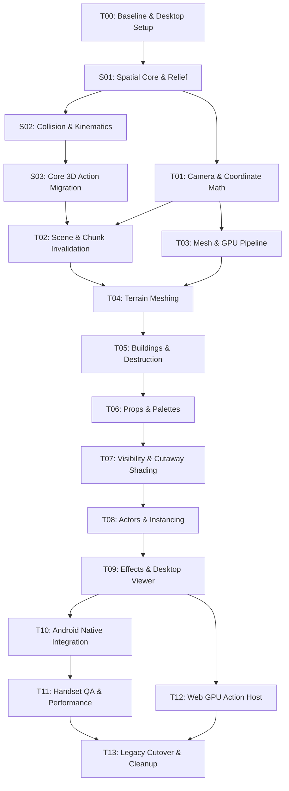

# Zombiebox 3D — Roadmap & Task Cards

This document outlines the implementation roadmap for the Zombiebox 3D migration. Each card describes a milestone's objective, design guidelines, and acceptance criteria. Tasks are framed at a high level so capable models can make autonomous decisions regarding file navigation, refactoring, and validation strategies.

---

## Migration Overview

---

## Phase 0: Baseline & Feasibility

### `T00` — Baseline Capture & Desktop GPU Setup
* **Objective:** Establish reference visual baselines from the existing CPU renderer and verify that `wgpu` builds cleanly on the workspace toolchain.
* **Key Guidelines:**
  * Capture baseline reference screenshots for key scenes (Birch Street and procedural county seed 42) using the legacy `preview` tool so visual parity can be verified throughout the migration.
  * Scaffold `crates/zombiebox-render3d` with `wgpu`, `glam`, and `bytemuck`. Keep GPU dependencies gated behind optional feature flags (e.g. `gpu` and `viewer`) so pure math and data structures build without GPU requirements.
  * Implement a simple headless offscreen smoke test (rendering a colored triangle or cube to a PNG) to confirm GPU device initialization and pipeline execution work on the host environment.
* **Acceptance Criteria:**
  * Reference screenshots captured and archived.
  * `zombiebox-render3d` builds cleanly both with and without GPU features.
  * Desktop headless GPU smoke test executes and outputs a valid image.

---

## Phase 1: Authoritative 3D Spatial Core (`zombiebox-core`)

### `S01` — Spatial Primitives, Terrain Grid & World Relief
* **Objective:** Introduce 3D spatial foundation types and continuous world elevation into `zombiebox-core`.
* **Key Guidelines:**
  * Define core spatial primitives (`Vec3`, `Aabb3`, `BodyShape`, `BodyState`, `MotionState`) in a dedicated spatial module. Standardize on `FLOOR_H ≈ 1.388` for vertical building floor increments.
  * Build a continuous height representation for the county (e.g., $513 \times 513$ height grid for a $512 \times 512$ world) using a consistent diagonal triangle split (such as `00 -> 11`) to ensure simulation elevation and rendering match.
  * Enhance terrain generation to compute deterministic continuous relief from seed data, ensuring flat building pads (`foundation_z`), reasonable road grades ($\le 0.20$), and stable river/lake water planes with submerged riverbeds.
  * Provide clean spatial query access on `World` (e.g. elevation, terrain cell, and normal queries).
* **Acceptance Criteria:**
  * Flat ground fixtures (e.g. Birch Street) remain at zero elevation without regressing existing behavior.
  * County terrain produces smooth, continuous heights and normals across chunk boundaries without tears.
  * Unit and integration tests verify deterministic terrain generation, flat building pads, and road slope constraints across multiple seeds.

### `S02` — Spatial Supports, Collision & Kinematics
* **Objective:** Implement physical support surface resolution, continuous collision detection, and swept kinematic movement.
* **Key Guidelines:**
  * Define traits and contracts (`SpatialWorld`, `SupportSurface`, `Ray3`, `Hit3`, `MoveResult`) for spatial queries.
  * Implement support selection that resolves the nearest reachable ground or floor surface within reasonable step bounds, preventing false ground snaps onto elevated structures (like bridges) when passing underneath.
  * Implement swept kinematic movement supporting gravity, step climbing, slope sliding, and continuous collision against dynamic geometry (doors, breached walls, stairs).
  * Provide an adapter connecting `ActionGame` world state (live tiles, doors, multi-floor structures, terrain) to the spatial query system.
* **Acceptance Criteria:**
  * Kinematic movement smoothly handles sloped terrain, stairs, step-ups, and falls.
  * High-speed sweeps and thin walls do not tunnel.
  * Wall breaching or opening doors immediately updates spatial collision results.
  * Synthetic and integration tests cover ramps, bridge underpasses, falls from collapsed floors, and raycasts.

### `S03` — Core Simulation 3D Migration
* **Objective:** Migrate player movement, entity states, monster AI, and weapons to authoritative 3D coordinates.
* **Key Guidelines:**
  * Update entity poses, views (`PlayerRenderState`, `MonsterView`, `ProjectileView`), and combat events to carry 3D `Vec3` positions while maintaining semantic floor information.
  * Route player movement, window vaults, stair navigation, and structural fall damage through the 3D kinematic solver.
  * Update monster pathfinding, movement, and line-of-sight checks to operate in 3D, respecting eye height and vertical obstruction.
  * Update weapon firing origins, projectiles, and blast volumes to perform 3D ray and sweep queries against terrain, buildings, and actors.
  * Provide compatibility shims where necessary so downstream crates compile during the transition.
* **Acceptance Criteria:**
  * Player and monsters move smoothly across varying terrain elevations and multi-floor buildings.
  * Weapons fire and collide accurately in 3D space, with line-of-sight properly blocked by roofs, upper floors, and hills.
  * Existing flat Birch Street combat and movement semantics remain fully preserved.
  * All workspace tests pass.

---

## Phase 2: Desktop 3D Engine & Interactive Viewer (`zombiebox-render3d`)

### `T01` — Coordinates, Camera Rigs & Input Mapping
* **Objective:** Establish coordinate transformations, camera projections, and analog stick input conversions.
* **Key Guidelines:**
  * Define conversions between simulation coordinates (`+z` up) and renderer coordinates (`+Y` up, CCW triangle winding).
  * Implement camera rigs supporting standard modes: Isometric (2:1 projection matching legacy look), Overhead, Orbit, Chase, and FirstPerson.
  * Calibrate the default isometric camera (`yaw = π/4`, `pitch = π/6`, ~28.28 px/unit) so world steps match legacy screen-space pixel displacements.
  * Implement input mapping that translates screen-relative virtual sticks into world-space vectors for each camera mode.
* **Acceptance Criteria:**
  * Camera projections transform world points to expected screen positions across all presets.
  * Input conversion accurately maps stick input to world movement directions for both isometric and perspective modes.
  * Unit tests verify camera matrices, unproject raycasting, and smooth damping.

### `T02` — Scene Management & Chunk Invalidation Cache
* **Objective:** Synchronize simulation state into renderable scene snapshots with fine-grained chunk caching.
* **Key Guidelines:**
  * Define snapshot data structures (`TileSnapshot`, `ChunkSnapshot`, `FrameSnapshot`) that capture visible world state from `ActionGame`.
  * Track per-chunk geometry fingerprints or revision counters so unchanged chunks are not rebuilt or re-uploaded.
  * Implement halo invalidation: when a tile at a chunk boundary changes (e.g. wall destruction), invalidate the neighboring chunk to prevent visible seam artifacts.
* **Acceptance Criteria:**
  * Camera-only movement triggers zero static geometry rebuilds.
  * Modifying dynamic world elements (opening a door, breaching a wall) dirties only the affected chunk and its immediate halo.
  * Tests verify chunk keying across negative coordinates, active streaming windows, and dirty-tracking behavior.

### `T03` — Mesh Primitives & GPU Render Pipeline
* **Objective:** Implement foundational 3D mesh builders and the core `wgpu` rendering pipeline.
* **Key Guidelines:**
  * Build reusable low-poly mesh generators (quads, cuboids, cylinders, ramps) ensuring consistent vertex formats, normals, and CCW winding.
  * Set up depth-tested render pipelines (`Depth32Float`, backface culling) with support for static chunk buffers and dynamic instance batches.
  * Implement an internal low-resolution render target with a nearest-neighbor upscale pass to the presentation window, maintaining the game's retro aesthetic.
  * Provide headless offscreen rendering capabilities for testing and preview CLI tools.
* **Acceptance Criteria:**
  * Correct triangle winding and depth testing verified by render tests.
  * Headless preview example successfully renders test geometry and outputs clean PNGs across different aspect ratios.

### `T04` — 3D Terrain & Surface Meshing
* **Objective:** Generate continuous 3D terrain meshes from county elevation data.
* **Key Guidelines:**
  * Mesh all surface types (grass, dirt, roads, pavement, water) using elevation data and the standardized diagonal triangle split.
  * Emit road surfaces and markings with slight vertical offsets to eliminate z-fighting.
  * Generate flat water planes at appropriate water elevations and separate bridge deck surfaces with approach ramps.
  * Ensure adjacent chunk edges share exact boundary vertex positions and normals.
* **Acceptance Criteria:**
  * Terrain meshes render smoothly across varied topography without cracks or visual seams between chunks.
  * Bridges, roads, and waterways visually align with their physical walkable surfaces.
  * Visual inspection via preview captures confirms proper terrain rendering across multiple seeds.

### `T05` — 3D Buildings, Openings & Destruction
* **Objective:** Procedurally generate 3D multi-floor building geometry, openings, stairs, and structural destruction.
* **Key Guidelines:**
  * Reference existing building generation logic in `crates/zombiebox-render/src/street.rs` to derive wall segments, door frames, window openings, and multi-floor cutaways.
  * Mesh walls, doors (supporting open/closed states), windows (intact/broken), interior floor slabs, and stairs matching physical ramps.
  * Support flat and pitched roofs, ensuring roofs clip cleanly to chunk boundaries and collapse when supporting walls are destroyed.
  * Tag geometry into appropriate classes (e.g. ground, interior, wall lower/upper, roof) to support dynamic cutaway visibility.
* **Acceptance Criteria:**
  * Multi-floor houses and district buildings render with accurate dimensions, stairs, and openings.
  * Breaching walls and damaging structures visually updates the 3D mesh.
  * Roofs render properly and collapse cleanly when supports are removed.

### `T06` — Props, Caches & District Palettes
* **Objective:** Add 3D prop models, loot caches, streetlamps, and environmental material palettes.
* **Key Guidelines:**
  * Create lightweight 3D models for county props (trees with trunks and canopies, streetlights, fences, rubble, and loot caches).
  * Build a material registry mapping building and district styles to cohesive retro color palettes.
  * Allow loot cache interaction (opened vs. unopened) to update efficiently via instance data or appearance states without forcing static chunk rebuilds.
* **Acceptance Criteria:**
  * All common props and caches render in appropriate district themes.
  * Cache opening updates visual state smoothly.
  * Visual tests confirm proper placement and orientation of props across residential, commercial, and rural districts.

### `T07` — Visibility, Cutaways & Shading
* **Objective:** Implement room visibility rules, interior cutaways, dynamic lighting, and environmental effects.
* **Key Guidelines:**
  * Replicate gameplay visibility logic: hide unvisited interiors, cut away roofs and upper walls when the player is inside, and apply fog-of-war to unexplored areas.
  * Implement screen-door dither or alpha-tested cutaway shading for upper walls and roofs so interior action remains readable.
  * Integrate directional sunlight/moonlight, ambient dusk lighting, streetlamp point lights, and dynamic muzzle/explosion flashes into the shader pipeline.
  * Ensure gameplay camera perspectives never reveal hidden interior content through camera rotation alone.
* **Acceptance Criteria:**
  * Entering buildings smoothly cuts away roofs and reveals interiors.
  * Dusk lighting, streetlights, and weapon flashes illuminate the scene properly.
  * Visibility rules prevent unintended peeking into unexplored rooms from orbit/free cameras.

### `T08` — Articulated Actors & Instanced Animation
* **Objective:** Render 3D animated characters for survivor and infected archetypes using GPU instancing.
* **Key Guidelines:**
  * Build rigid-part character meshes (torso, head, limbs, equipped weapons) for survivor and zombie archetypes (Shamblers, Brisk, Bloaters, Shooters).
  * Implement procedural skeletal or rigid-part gait animations driven by simulation movement and speed.
  * Support hit reactions, aiming rotations, attack telegraphs, and corpse states.
  * Render actors using efficient GPU instancing grouped by archetype.
* **Acceptance Criteria:**
  * Survivor and infected display clear, expressive locomotion and combat feedback.
  * Aim direction and weapon attachments align accurately with 3D targeting.
  * Instanced rendering maintains high frame rates with 100+ active actors on screen.

### `T09` — Effects, Obstruction & Interactive Desktop Viewer
* **Objective:** Finalize dynamic visual effects, camera obstruction handling, and deliver a fully interactive desktop test application.
* **Key Guidelines:**
  * Implement particle systems and transient effects (muzzle flashes, tracers, impacts, blood, smoke, explosions) driven by simulation event feeds.
  * Implement camera obstruction resolution (e.g. sphere-casting or dither fade) to prevent exterior walls or terrain from occluding the survivor in Chase or Orbit modes.
  * Assemble the unified `Presentation` facade coordinating camera, scene, actors, and effects.
  * Build an interactive desktop viewer executable (`examples/viewer.rs`) allowing live gameplay, real-time camera switching (keys 1–5), free orbit, and performance metric display.
* **Acceptance Criteria:**
  * Live desktop viewer runs smoothly with full combat, movement, scavenging, and real-time camera switching.
  * Obstruction handling keeps the player visible when standing behind high walls or structures.
  * Transient visual effects trigger cleanly from action events without leaking memory or dropping frames.

---

## Phase 3: Host Integrations (Android & Web)

### `T10` — Android Native Integration (FFI, JNI & SurfaceView)
* **Objective:** Connect the 3D renderer to the Android native runtime.
* **Key Guidelines:**
  * Extend Rust FFI exports (`zombiebox-ffi`) to support 3D presentation, camera controls, and native surface attachment.
  * Update JNI bindings to manage `ANativeWindow` references cleanly, initializing GPU devices asynchronously to avoid blocking the Android UI thread.
  * Integrate with the mobile frontend via a native `SurfaceView` component, ensuring clean lifecycle handling during app backgrounding, surface destruction, and screen rotation.
* **Acceptance Criteria:**
  * Android native libraries (`arm64-v8a`, `x86_64`) build successfully with 3D GPU support.
  * The native app launches, creates a GPU surface, renders the 3D scene, and responds to touch controls.
  * Backgrounding and resuming the app preserves game state and surface lifecycle without crashing.

### `T11` — Handset QA & Performance Tuning
* **Objective:** Validate real-world performance, frame pacing, and visual stability on physical Android hardware.
* **Key Guidelines:**
  * Conduct playtesting sessions on target physical Android handsets across diverse scenarios (dense downtown, residential cutaways, large zombie hordes, rapid traversal).
  * Measure frame intervals (targeting smooth 60 FPS / p95 $\le 16.7$ ms), memory footprint, thermal stability, and battery impact.
  * Tune dynamic resolution scaling, render distances, and frustum culling as needed to meet performance targets without compromising visual clarity.
* **Acceptance Criteria:**
  * Stable frame pacing verified on physical hardware across extended play sessions.
  * No memory leaks, GPU context loss crashes, or visual artifacts during scene transitions.
  * Performance telemetry and test results documented in the progress ledger.

### `T12` — Web GPU Action Host
* **Objective:** Update the web server and browser client to support the 3D rendering pipeline.
* **Key Guidelines:**
  * Adapt `zombiebox-web` to utilize the 3D `Presentation` layer and headless GPU rendering for browser streaming sessions.
  * Maintain compatibility with the web control harness and streaming protocol while providing access to camera switching.
* **Acceptance Criteria:**
  * Browser client successfully connects, streams frames rendered via the 3D engine, and accepts player inputs.
  * Web test suite passes cleanly.

---

## Phase 4: Single-Renderer Cutover

### `T13` — Legacy Cutover & Cleanup
* **Objective:** Retire the legacy 2D CPU renderer and finalize `zombiebox-render3d` as the sole production action renderer.
* **Key Guidelines:**
  * Remove `crates/zombiebox-render/` and obsolete 2D bitmap FFI export paths.
  * Clean up temporary compatibility shims, feature gates, and fallback toggles.
  * Update project documentation (`README.md`, `architecture.md`, `product-decisions.md`) to reflect the completed 3D pipeline.
* **Acceptance Criteria:**
  * Workspace compiles cleanly with zero references to the deleted legacy renderer.
  * All CI checks, tests, and native verification scripts pass.
  * Sideloadable Android APK and web playtest run solely on the unified 3D renderer.
