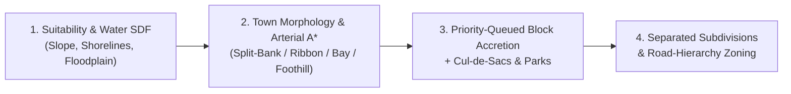
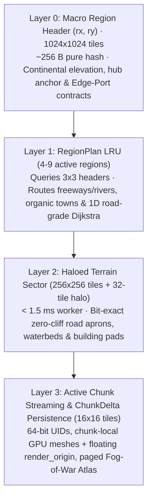

# Organic town layout, regional highways, and infinite world plan

Companion to [living-buildings-plan.md](living-buildings-plan.md) and [world-design.md](world-design.md). Covers breaking out of the current `5 × 5` rectangular town grid into organic towns, separated neighborhoods, freeways with gas stations and rural micro-sites, and scaling long-term from a `512 × 512` valley to a **practically-infinite seeded world**.

---

## 1. Current macro-layout & `512 × 512` bottlenecks

### 1.1 Why towns are always `5 × 5` rectangles today
- **Fixed `6 × 6` street lattice (`world/geography.rs`):** `xs: [i32; 6]` and `ys: [i32; 6]` always stamp a `5 × 5` matrix of 25 rectangular lots framed by an unbroken perimeter ring road (`xs[0]`, `xs[5]`, `ys[0]`, `ys[5]`).
- **Rigid box sliding instead of contour hugging:** `bank_setback` shifts the entire town west of the river without ever bridging to a sister bank, and southern lake overlaps slide the whole rigid grid north (`y -= 4`) rather than wrapping around a bay.
- **Box terrain mask (`world/relief.rs`):** `ValleyMeta` passes a single `(town_min, town_max)` rectangle to damp hilliness, and zoning hardcodes `Hospital` and `Police` to fixed matrix indices.

### 1.2 Hardcoded `WORLD_SIZE = 512` assumptions across the stack
| Area | Current assumption | Impact beyond `512 × 512` |
| --- | --- | --- |
| **World & terrain buffers** (`world.rs`, `parcels.rs`, `spatial/terrain.rs`) | Eager flat `tiles: Vec<Tile>` (`512²`), `owner: Vec<u16>`, `TerrainGrid` (`513²`), `0..WORLD_SIZE` bounds checks, finite `NoiseLattice<SIDE>`. | Memory scales as `O(W^2)`; negative coordinates fail bounds checks; noise clamps flat outside `512`. |
| **Global relief Dijkstra** (`world/relief.rs`) | Runs global two-pass road Lipschitz Dijkstra + BFS bands across all `513²` vertices at once. | Cannot stream lazily without cross-boundary elevation contracts. |
| **Chunk & monster tables** (`action/county.rs`) | Fixed `1024`-slot `Vec`s indexed by `(cy << 5) \| cx`; chunks never evict. | Corrupts on `cx < 0` or `>= 32`; unbounded exploration exhausts RAM. |
| **Entity & building IDs** (`action/types.rs`, `county.rs`) | `BuildingId = u16` & `CacheId = u16` assigned in chunk-visit order; `MonsterId(u32)` tied to `cidx`. | Non-deterministic IDs across different travel routes; `u16` overflows past `65,535` buildings/caches. |
| **GPU `f32` world coordinates** (`render3d/src/mesh/`, `world.wgsl`) | Static chunk vertices store absolute world `f32` `(cx * 16 + lx - 0.5)` with identity instancing. | Far from `(0, 0)` (e.g. `100k` tiles), `f32` ULP hits `~8 mm`, causing vertex swimming, road-marking Z-fighting, and room-shroud seam flicker. |
| **Field Atlas** (`survey.rs`) | Serializes the entire `512²` county and forces all `OnceLock` parcels at once (`> 1 MB` JSON). | Unbounded or large multi-region worlds require paged, fog-of-war-aware streaming. |

---

## 2. Organic town & neighborhood generation

### Core rule: Organic macro skeletons + crisp orthogonal parcels
Keep individual `Lot`s and `ParcelPlan`s axis-aligned (`North | South | East | West` frontage) so walls, explicit `DoorAxis`, `3×3` doorway stencils, and stepped roofs stay crisp on the tile grid, while making **arterials, shorelines, block footprints, and neighborhood clusters organic**:

1. **Four seed-selected town morphologies:**
   - **Riverfront / Split-Bank Town:** Main Street parallels the river bluff (`6–10` tile waterfront park/dock setback) with `1–2` bridges crossing to a **Sister Bank** residential/commercial district.
   - **Highway / Main-Street Ribbon Town:** Elongated (`~3:1`) commercial corridor (gas station, motel, grocery, storefronts) tapering quickly into shallow residential side streets.
   - **Lakeshore / Bay-Hugging Town:** Collector spine traces the `water_sdf ∈ [5, 9]` contour around a lake bay (replacing the rigid `y -= 4` slide) with a public dock and terraced hillside streets.
   - **Foothill / Pass Town:** Tucked into a mountain pass mouth; streets climb gentle drumlinoid benches and terminate as cul-de-sacs or trailheads where `slope > 0.16`.
2. **Priority-queued block accretion & ragged fringes:**
   - Seed a `2×3` or `2×4` Main Street Downtown core on the primary arterial and grow blocks outward via a deterministic suitability priority queue (`water_sdf`, `slope`, `decay(depth)`).
   - **No rectangular ring road:** Reject steep/wet outer faces, offset `~35%` of residential cross-streets into **T-junctions**, end outer stubs in paved **`5×5` Cul-de-Sac bulbs**, and convert a prime block into a **Town Plaza / Waterfront Park**.
3. **Separated satellite neighborhoods:**
   - Place `1–2` dry pockets `35–85` tiles outside town connected only by a `Collector` road through woods or fields — such as a named **Suburban Subdivision** (single entry road + readable sign + loop/cul-de-sac streets of Ranch/Split-Level houses) or **Lakeside Cottages / Trailer Park**.
4. **Road-hierarchy zoning:**
   - **Downtown** takes highest-centrality arterial blocks; **Grocery Stores** take wide arterial-approach lots with front asphalt parking lots; **Police Stations** sit on arterial/collector corners (`1–2` blocks from Downtown with side-street sallyport access); **`4–6F` Hospitals** claim merged arterial superlots (`36×34+`) with separate main-lobby and ambulance-bay approaches; **Houses** fill quiet local streets and subdivisions.

---

## 3. Regional layout: freeways, gas stations, woods & compounds

Upgrade rural space into a structured **5-tier road hierarchy** punctuated by purposeful roadside stops every `400–800m`:

1. **Five-tier `RoadClass`:**
   - **`Freeway` (`8–9` tiles wide):** Dual `3`-tile directional carriageways split by a grass median or concrete **Jersey barrier** (`~9%` max Lipschitz grade for smooth `40+ mph` motorcycle leaning). Skirts town cores and links to arterials via **Freeway Exit Interchanges** (flared slip-lane express junctions near-term; diamond overpasses reusing `SupportId::Bridge` later).
   - **`Arterial` State Highway (`5–6` tiles):** `4`-tile roadway + gravel shoulders, yellow centerline, guardrails on embankments, and readable **green highway guide signs** (`InteractPrompt::Read`).
   - **`Collector` (`4–5` tiles):** Connects satellite subdivisions, crossroads hamlets, marinas, and compounds.
   - **`LocalStreet` (`5` tiles):** `3`-tile asphalt + raised curbed `Sidewalk`s + streetlights.
   - **`Trail` (`2–3` tiles):** Winding dirt/gravel forest and mountain tracks.
2. **Roadside & wilderness micro-sites (all built as `ParcelPlan`s):**
   - **Freeway / Highway Service Stops:** **Gas Station & Mini-Mart** (illuminated canopy over fuel-pump islands, store, garage bay, high vehicle spawn rate), **`2F` Roadside Motel** (exterior balcony rooms around a parking court), and **Highway Diner / Rest Stop** (bulletin board + parking apron).
   - **Crossroads Hamlets:** Small rural intersection clusters (`Country Store` + single pump, barn, `2–4` farmhouses).
   - **Woods, Mountains & Water:** Secluded **Cabins**, **State Park Campgrounds** (loop road, tents, bathhouse, readable trailhead map), **Fire Lookout / Ranger Stations**, and **Lakeside Marinas / Docks** (future motorboat spawns).
   - **Large Special Compounds (`48×48` to `80×64` clearings):** **Traveling Circus / Fairground** on a rural collector clearing, and later the **Fortified Army Base + `70×14` Airstrip** when tanks and planes arrive.

---

## 4. Long-term architecture: scaling to a practically-infinite world

### Solving connected roads, downhill rivers & smooth grades without global arrays
Pure Perlin noise cannot connect freeways or guarantee acyclic downhill rivers; global arrays (`World::new`) cannot scale infinitely. We solve both with a **4-Layer Bounded-Radius Hierarchy**, where each coordinate at layer `L` depends *only* on a `3 × 3` neighborhood of layer `L - 1` (`O(1)` time and memory at any distance):

1. **Layer 0 — `1024 × 1024` Region Headers & Deterministic Edge-Port Contracts:**
   - Stateless unbounded noise (`world_fbm(seed, domain, wx, wy)`) replaces `NoiseLattice<SIDE>`.
   - Shared borders between `(rx, ry)` and `(rx+1, ry)` / `(rx, ry+1)` deterministically agree on crossing ports purely from `(seed, edge_id)`: **`FreewayPort`** (`0..=1` on an interstate super-grid), **`HighwayPort`** (`1..=2` at pass saddles), and **`RiverPort`** (`0..=1` directed from higher basin elevation to each region's strictly lowest 4-neighbor — forming an **acyclic drainage forest** where local-minimum basins terminate naturally in **Major Lakes**!). Each port pins exact `(pos, tangent, z_port)`.
2. **Layer 1 — Lazy `RegionPlan` LRU (`4–9` regions):**
   - Queries `3×3` Layer-0 headers, routes C1-continuous rivers and coarse-A* freeways/highways between ports and town anchors, solves **two-pass Lipschitz road grades on the 1D road graph alone (`< 2 ms`)** with pinned `z_port` boundary elevations, and generates towns, subdivisions, gas stations, and R-tree/bucketed `Parcel` headers.
3. **Layer 2 — Haloed `256 × 256` Terrain Sectors (Zero-Cliff Seams):**
   - Stages 3–5 of `relief.rs` (road-apron Jacobi blend, `8`-tile waterbed Chebyshev distance, pad apron relaxation) have an exact maximum dependency cone of **`24` tiles**. Solving each `256 × 256` sector with a **`32`-tile halo** guarantees **bit-identical `f32` vertex heights and normals** across every sector and region seam in `< 1.5 ms`.
4. **Layer 3 — Unbounded Streaming, 64-Bit IDs, Floating Render Origin & Paged Atlas:**
   - **Chunk LRU + `ChunkDelta`s:** Replace `1024`-slot vectors with `LruMap<ChunkCoord, CountyChunk>` (`~128` resident chunks) + `HashMap<ChunkCoord, ChunkDelta>` storing *only* player/combat mutations (unmodified chunks evict to **0 bytes**!). Track moved/wrecked seeded vehicles via tombstones + live `BTreeMap<VehicleId, VehicleState>`.
   - **Deterministic 64-bit IDs + recycled GPU slots:** Use `BuildingUid(u64)` `(rx, ry, parcel, struct)` for persistence while recycling `BuildingId(u16)` (`1..=4095`) as a resident GPU cutaway-LUT handle (zero shader/vertex changes!). Upgrade `CacheId(u64)` and `MonsterId(u64)` to `(cx: i24, cy: i24, slot)`.
   - **Floating `render_origin` (`zombiebox-render3d`):** Emit static chunk meshes in **chunk-local `[-0.5, 16.5]` space** and pass each chunk's `(chunk - focus_chunk) * 16` translation via `InstanceRaw`. Shifting `focus_chunk` requires **zero chunk mesh rebuilds** and keeps `world.wgsl` coordinates within `[-64, +64]` (`ULP <= 3.8 µm`) even millions of tiles from `(0, 0)`.
   - **Paged Fog-of-War Field Atlas:** Serve `256 × 256` atlas pages on demand with survivor exploration reveal + **signpost/wall-map discovery** (`InteractPrompt::Read` on highway signs or trail maps reveals signposted landmark pins ahead of arrival).

---

## 5. Two-horizon rollout (near-term payoff, zero throwaway work)

- **Horizon 1 (Near-Term — `Generator v3` Expanded Organic Valley, `512²` or `1024²`):**
  - Replace the `5×5` town grid with organic **Block Accretion**, 4 town morphologies (including split-bank river bridges), `1–2` separated **Satellite Subdivisions**, **Freeway / State Highway** corridors, and **Gas Station / Motel / Hamlet** roadside micro-sites.
  - Land low-cost **forward-compatible hygiene** right alongside Living Buildings: unbounded noise, smooth per-parcel `urban_mask` in `relief.rs`, `(ChunkCoord, slot)` 64-bit IDs + recycled `u16` GPU `BuildingId`, and chunk-local meshes with a floating `render_origin`.
- **Horizon 2 (Long-Term — `Generator v4` Practically-Infinite World):**
  - Introduce Layer 0 `EdgePort` contracts, Layer 1 `RegionPlan` LRU, Layer 2 haloed `256×256` terrain sectors, `CountyChunk` eviction into `ChunkDelta`s, `WorldPos { chunk, local }`, and the paged Fog-of-War Field Atlas — scaling seamlessly to cross-country road trips and fixed-wing flight without rewriting a single building, prop, vehicle, or shader rule.
