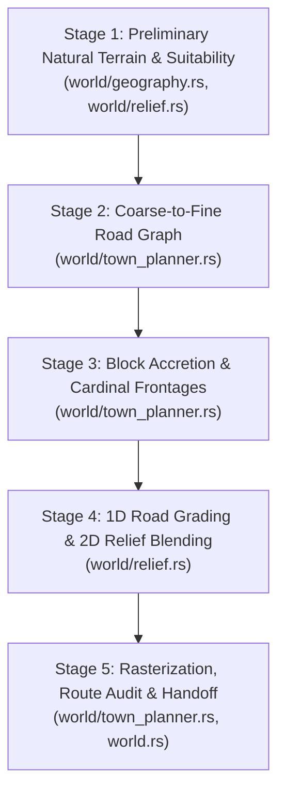

# Research Brief: WP 3.8 — Natural Terrain & Highway-Ribbon Town

**Target Work Package:** WP 3.8 (`docs/phase3-implementation-plan.md`)  
**Companion Architecture:** `docs/world-and-town-layout-plan.md`  
**Owned Modules:** `crates/zombiebox-core/src/world.rs`, `world/geography.rs`, `world/relief.rs`, and new `world/town_planner.rs`

---

## 1. Audit of Existing Docs: What Is Defined vs. Missing

Neither `phase3-implementation-plan.md` nor `world-and-town-layout-plan.md` contains a complete implementation-level algorithm spec for WP 3.8, though together they lock down the **product goals, module boundaries, and invariants**:

| Dimension | Already Specified in Existing Docs | Gaps Resolved by This Brief |
| :--- | :--- | :--- |
| **Core Problem** | Break out of the rigid `$5 \times 5$` street lattice (`xs: [i32; 6]`, `ys: [i32; 6]`), box-sliding river/lake avoidance, and rectangular `ValleyMeta` terrain mask. | Concrete data flow for decoupling natural terrain sampling from road/pad grading. |
| **Road Network** | 4 Phase 3 road classes (`Arterial`, `Collector`, `LocalStreet`, `Trail`), `$16$`-tile coarse routing grid, explicit tie-breaks, `$5 \times 5$` cul-de-sac bulbs, `$\approx 35\%$` T-junctions. | Exact anisotropic A* cost function, heading-change regularization, spline/rasterization rules, and motorcycle curvature bounds. |
| **Town Shape** | Highway-ribbon morphology (`$\approx 3:1$` elongated commercial corridor tapering into shallow residential streets) + dry reachable residential block. | Priority-queued block accretion scoring, frontage extraction along curved/diagonal roads, and clean WP 3.8 to WP 3.9 handoff types. |
| **Relief & Grading** | Pads before final relief; two-pass road Lipschitz Dijkstra; `$\approx 9\%$` max highway grade for `$40+$` mph motorcycles; replace rigid `ValleyMeta` box. | Coupled 1D road-profile grading + smooth `urban_mask` + bounded-radius heightfield blending compatible with Horizon 2's `$256 \times 256$` haloed sectors. |
| **Cutover & Testing** | Opt-in seed fixture first, then cutover primary game mode; canonical road hashes; motorcycle grade/turn check; resolve `county_seed_42_terrain_seam_and_diagonal_raycasts` baseline. | Concrete numeric pass/fail gates, RNG stream isolation rules, and incremental implementation sequence. |

---

## 2. Design Goals & Hard Constraints

### 2.1 Why Highway-Ribbon Towns Feel Real
Authentic rural highway-ribbon towns emerge from three interacting pressures rather than uniform grids:
1. **Civil engineering cost:** The state highway follows the path of least resistance—hugging valley floors or benches, avoiding water and steep grades, and sweeping in broad, surveyed curves rather than sharp `$90^\circ$` kinks.
2. **Economic frontage vs. residential quiet:** Commercial parcels compete for flat, visible highway frontage near the town core and approaches. Residential streets peel off onto quieter, gently rising side benches and terminate in T-junctions or cul-de-sacs when slope or water intervenes.
3. **Topographic opportunism:** Road decks and building pads are cut-and-filled smoothly into the hillside, while awkward or steep pockets remain wooded buffers rather than forced lots.

### 2.2 Architectural Contracts WP 3.8 Must Honor
* **Organic macro skeleton, crisp orthogonal parcels:** Arterials, shorelines, and block clusters are organic, but every lot handed to WP 3.9 must resolve to an axis-aligned `GridRect` with a cardinal `Frontage` (`North | South | East | West`). This preserves `BlueprintGrid`, `DoorAxis`, `$3 \times 3$` doorway clearance stencils, and stepped roofs without arbitrary-angle wall hacks.
* **Strict determinism & stream isolation:** Independent RNG streams keyed by `(seed, owner_id, stage_salt)` for roads, blocks, and layout. Every priority queue, candidate scan, and graph traversal must use explicit deterministic tie-breakers (e.g., canonical `(cost_bits, node_id)` or `(y, x)`), never hash-map iteration order.
* **WP 3.8 vs. WP 3.9 boundary:**
  * **WP 3.8 owns:** Natural suitability fields, connected road graph + fine raster, highway ribbon + collector + residential street/cul-de-sac, graded relief + `urban_mask` / `ValleyMeta` replacement, candidate frontage/block extraction, and spawn-to-district route verification.
  * **WP 3.9 owns:** Fine lot subdivision (frontage-preserving splits), regional grocery/gas site assignment, detached subdivision population, and `OutdoorLayer` consumption in `world/dressing.rs`.
* **WP 3.10 extensibility:** Keep town morphology selection parameterized (portals, spine count, shoreline/river rules) so **Crossroads**, **Split-Bank**, and **Bay/Lakeshore** reuse the exact same graph, accretion, and grading pipeline.
* **Horizon 2 (Infinite World) hygiene:**
  * Sample natural terrain via stateless world-space noise (`world_fbm(seed, domain, wx, wy)`) rather than adding new dependencies on finite `NoiseLattice<SIDE>`.
  * Solve road elevations on the **1D road graph** before 2D apron blending, and keep 2D relief blending strictly within the `$24$`-tile dependency cone documented in `world-and-town-layout-plan.md`.

---

## 3. Recommended 5-Stage Pipeline



### Stage 1: Preliminary Natural Terrain & Suitability Field
Expose a pure, read-only natural terrain sampler (`NaturalTerrainField`) from `relief.rs` / `geography.rs` **before** any roads or pads are placed. Over the `$512 \times 512$` county (and downsampled to the `$16$`-tile coarse routing grid, i.e., `$32 \times 32$` macro-cells):

1. **Raw Elevation $H_0(x, y)$:** Deterministic valley/basin macro-shape plus multi-octave fBm noise (no town flattening applied yet).
2. **Water Mask & Signed Distance $D_w(x, y)$:** Exact waterbody classification (river, lake, marsh) plus Euclidean/Chamfer SDF in tiles. Negative inside water, positive on dry land.
3. **Natural Slope $S_0(x, y) = \|\nabla H_0(x, y)\|$:** Central-difference gradient magnitude.
4. **Buildability Score $B(x, y) \in [0, 1]$:**
   $$B(x, y) = \mathbf{1}[D_w(x,y) \ge d_{\text{min}}] \cdot \text{clamp}\!\left(1 - \frac{S_0(x, y)}{S_{\text{max}}}, 0, 1\right) \cdot E_{\text{margin}}(x, y)$$
   where $d_{\text{min}} \approx 4$ tiles from water, $S_{\text{max}} \approx 0.16$ (16% grade), and $E_{\text{margin}}$ tapers near the `$512 \times 512$` world border.
5. **Town Core Anchor Selection:** Convolve $B(x, y)$ with a wide box/Gaussian kernel (radius `$24\text{--}36$` tiles). The highest local maximum with sufficient dry elongation (`$\ge 90$` tiles along a low-slope corridor) defines the **Highway-Ribbon Core Anchor** $(x_c, y_c)$ and its preferred spine axis $\hat{u}_{\text{spine}}$.

---

### Stage 2: Coarse-to-Fine Terrain-Aware Road Graph (`world/town_planner.rs`)

Represent the road network as a canonical graph `RoadGraph { nodes: Vec<RoadNode>, edges: Vec<RoadEdge> }`, where each edge carries `RoadClass`, width, polyline control points, and optional `BridgeSpan` metadata.

#### Tier A — State Highway Spine (`Arterial`, `$5\text{--}6$` tiles wide)
Route the highway between two opposing county-edge portals through the Town Core Anchor $(x_c, y_c)$ using **Anisotropic A* on the `$16$`-tile coarse grid** (inspired by Galin et al., *Procedural Generation of Roads*):

* **State space:** `(cell_x, cell_y, incoming_dir_idx)` using 8-neighbor or 16-direction (knight-move) transitions so heading changes can be penalized directly.
* **Edge traversal cost:**
  $$C(p \to q) = d(p, q) \cdot \Big(1 + w_s \cdot \max(0, \text{grade}(p, q) - g_0)^2 + w_e \cdot \text{elev}(q) + w_w \cdot P_{\text{water}}(p, q) + w_\kappa \cdot \Delta\theta^2\Big)$$
  * **Grade penalty ($w_s$):** Strongly penalizes longitudinal grades above $g_0 = 0.06$ and rejects impassable cliffs ($> 0.18$).
  * **Turn penalty ($w_\kappa \cdot \Delta\theta^2$):** Prevents A* from zig-zagging along contour noise, producing sweeping, highway-engineered curves.
  * **Water penalty ($P_{\text{water}}$):** Prohibits longitudinal travel in water; only permits short, roughly orthogonal crossings at narrow river pinch points (flagged as candidate `BridgeSpan`s for WP 3.10 or fallback crossings).
  * **Deterministic tie-break:** Binary heap ordered by `(f_score_quantized, g_score_quantized, node_y, node_x, dir_idx)`.
* **Fine-grid smoothing & motorcycle kinematics pass:**
  * Fit a Centripetal Catmull-Rom or quadratic B-spline through the coarse A* waypoints and sample at `$\approx 2$`-tile arc-length intervals.
  * Enforce a **minimum turning radius** $R_{\min} \ge 18$ tiles (via iterative curvature relaxation) so `$40+$` mph motorcycle leaning remains smooth and predictable.

#### Tier B — Collector, Residential Side Streets & Cul-de-Sacs
Avoid global tensor fields (overkill and overly dense for a `$512 \times 512$` rural valley). Use a **constrained priority-queue branching generator**:

1. **Junction seeding along the ribbon core:** Walk the highway spine inside the town core zone (e.g., `$\pm 70$` tiles of $(x_c, y_c)$). Place `Collector` and `LocalStreet` T-junctions at spaced intervals (`$28\text{--}48$` tiles apart), alternating sides where $B(x, y)$ is high.
2. **Cardinal-biased local growth:**
   * Launch residential branches roughly perpendicular to the highway, snapping their heading to the nearest **cardinal direction** (`N/S/E/W`) whenever terrain slope allows ($S_0 \le 0.12$). Cardinal residential streets yield clean, fence-to-fence `GridRect` neighborhoods.
   * For `$\approx 35\%$` of internal cross-streets, offset intersections by `$8\text{--}16$` tiles into **T-junctions** rather than 4-way crossroads to break up grid monotony.
3. **Organic termination & cul-de-sacs:**
   * If a branch approaches an existing street within snap distance (`$12\text{--}18$` tiles), connect it into a short residential loop.
   * If a branch encounters steep slope ($S_0 > 0.13$), water ($D_w < 5$), or reaches max spur length (`$36\text{--}64$` tiles) without looping, terminate it in a paved **`$5 \times 5$` Cul-de-Sac bulb** (validated dry and flat enough for a motorcycle U-turn).
4. **Starter residential street guarantee:** Explicitly score and select the highest-suitability dry `LocalStreet` branch off the primary `Collector` near spawn as the **starter residential district** so WP 3.2–3.5 houses always have a verified home.

---

### Stage 3: Priority-Queued Block Accretion & Cardinal Frontages

Rather than subdividing closed polygons with Straight Skeletons ($O(N^3 \log N)$, poor fit for tile grids) or rigid OBB splits, use **Priority-Queued Block Accretion + Road-Frontage Strip Extraction**:

1. **Accrete buildable blocks along road edges:**
   * Seed the priority queue with candidate frontage intervals along the highway core (`~3:1` elongated commercial strip) and the connected residential `LocalStreet` / `Collector` edges.
   * Score each candidate block cell/slot by:
     $$\text{Score}(b) = w_B \cdot \bar{B}(b) + w_d \cdot e^{-\text{dist}(b, \text{core}) / \lambda} + w_a \cdot \text{arterial\_bonus}(b) - w_\sigma \cdot \text{relief\_std}(b)$$
   * Pop highest-scoring candidates until the target town footprint is met, leaving `$15\text{--}25\%$` of marginal or sloped fringe slots open as wooded buffers or park space (no perimeter ring road).
2. **Bridge curved highways to cardinal `GridRect` lots:**
   * For every accepted frontage interval along a road segment, quantize the road outward normal to the nearest cardinal direction (`North | South | East | West`).
   * Project an axis-aligned `GridRect` candidate outward past the road right-of-way (half-width + shoulder + sidewalk setback).
   * **Diagonal/curved highway handling:** Where the highway runs diagonally, **stair-step** the axis-aligned `GridRect` pads along the curve and record an explicit `FrontageConnector` span (driveway/apron bridge of `$1\text{--}4$` tiles) between the parcel's cardinal `Frontage` edge and the curved highway raster edge. This keeps every building strictly orthogonal while the highway remains gracefully curved.
3. **Emit WP 3.9-ready `CandidateBlock` / `FrontageSlot` records:**
   * Guarantee every emitted block/slot is dry ($D_w \ge 4$), non-overlapping with any road corridor or other block, and satisfies minimum depth/width bounds (residential: `$12\text{--}18$` wide `$\times$` `$14\text{--}22$` deep, `$\ge 8$` tiles usable frontage; commercial/retail: wider arterial-facing pads reserved for WP 3.9).

---

### Stage 4: Coupled 1D Road Grading & 2D Relief Blending (`world/relief.rs`)

This implements the **"pads before final relief"** invariant and eliminates the rigid `ValleyMeta` box mask:

1. **Replace rigid `ValleyMeta` box with `urban_mask`:**
   * Retain `ValleyMeta` (or a thin compatibility struct) for any legacy/bridge callers, but replace its single `(town_min, town_max)` damping rectangle with a smooth per-tile `urban_mask(x, y) \in [0, 1]` derived from the accreted town blocks and road corridors (blurred with a `$\approx 12\text{--}16$`-tile falloff).
2. **Pass 1 — 1D Road-Graph Elevation Solve:**
   * Sample raw $H_0$ at every `RoadNode` and polyline sample point.
   * Pin intersection elevations first so side streets meet the highway flush with zero step/lip.
   * Run **two-pass Lipschitz relaxation** along the 1D road edges to enforce class-specific max longitudinal grades:
     * `Arterial`: `$\le 0.08\text{--}0.09$` (smooth `$40+$` mph motorcycle leaning).
     * `Collector` / `LocalStreet`: `$\le 0.11\text{--}0.12$`.
     * `Cul-de-Sac` bulb: flat (`$\le 0.03$` across the `$5 \times 5$` pad).
3. **Pass 2 — Planned Pad `foundation_z`:**
   * For each planned building pad, set:
     $$z_{\text{pad}} = \text{clamp}\!\left(0.7 \cdot z_{\text{frontage}} + 0.3 \cdot \bar{H}_0(\text{pad}),\; z_{\text{frontage}} - g_{\text{drive}} \cdot L_{\text{drive}},\; z_{\text{frontage}} + g_{\text{drive}} \cdot L_{\text{drive}}\right)$$
     where $g_{\text{drive}} \le 0.12$ prevents driveway cliffs.
4. **Pass 3 — Bounded-Radius 2D Heightfield Blend:**
   * Blend graded road decks, driveway corridors, and pads into $H_0(x, y)$ using an exact `$R_{\text{blend}} \le 16\text{--}24$`-tile smoothstep skirt:
     $$H_{\text{final}}(x, y) = (1 - w) \cdot H_0(x, y) + w \cdot H_{\text{target}}(x, y), \quad w = 1 - \text{smoothstep}(0, R_{\text{blend}}, d)$$
   * **Priority order:** Road deck > Bridge deck > Building pad > Driveway apron > Natural terrain.
   * Keeping $R_{\text{blend}} \le 24$ tiles preserves exact compatibility with Horizon 2's `$32$`-tile haloed `$256 \times 256$` terrain sectors.

---

### Stage 5: Road Rasterization, Connectivity Audit & Handoff

1. **Fine-grid rasterization:** Stamp each `RoadEdge` onto the `$512 \times 512$` tile grid using exact capsule/distance-to-polyline tests against its half-width (roadway + gravel shoulder for `Arterial`; roadway + raised curbed `Sidewalk` for `LocalStreet`), writing deterministic road metadata (`RoadClass`, centerline tangent, embankment guardrail hints).
2. **Route & kinematics verification (built into generator diagnostics):**
   * Run BFS/A* on the final materialized road raster from the county spawn point to the primary `Arterial`, the starter `LocalStreet`, and the `Cul-de-Sac` turnaround.
   * Sweep a motorcycle-width footprint along the primary highway, main junction, and cul-de-sac turnaround, verifying continuous grade and zero 1-tile pinch points or seam cliffs.
   * Compute a canonical **64-bit plan hash** over sorted `RoadNode`s, `RoadEdge`s, rasterized road tiles, and emitted `FrontageSlot`s for regression testing.

---

## 4. Algorithm Trade-Off Matrix

| Sub-Problem | Alternatives Considered | Recommended Choice | Rationale for `zombiebox` |
| :--- | :--- | :--- | :--- |
| **Highway Spine** | Tensor field streamlines; random spline control points | **Anisotropic A* (`$16$`-tile grid) + curvature-bounded spline** | Direct control over portals, water avoidance, grade caps, and motorcycle turning radius; trivial to make 100% deterministic. |
| **Side Streets** | Full L-system; Voronoi dual; `$5 \times 5$` lattice | **Constrained priority-queue spurs + T-junctions + `$5 \times 5$` cul-de-sacs** | Produces authentic rural ribbon topology without urban clutter; naturally scales to Crossroads and Split-Bank in WP 3.10. |
| **Lot/Block Layout** | Straight Skeleton; recursive OBB splitting | **Priority-queued block accretion + cardinal `GridRect` strip extraction** | Matches `ParcelPlan`'s cardinal `GridRect` + `Frontage` contract natively; handles curved highways cleanly via short `FrontageConnector` aprons. |
| **Terrain Grading** | Post-hoc per-chunk flattening; rigid `ValleyMeta` box | **1D Lipschitz road solve + smooth `urban_mask` + `$24$`-tile SDF blend** | Satisfies "pads before final relief", guarantees zero-cliff driveways/seams, and stays Horizon-2 ready. |

---

## 5. Proposed Data Contracts (WP 3.8 to WP 3.9/3.10 Seam)

Keep these conceptual types in `crates/zombiebox-core/src/world/town_planner.rs` (mapping onto existing `GridRect`, `CardinalDir`, and `RoadClass` types):

```rust
pub enum TownMorphology {
    HighwayRibbon, // WP 3.8
    Crossroads,    // WP 3.10
    SplitBank,     // WP 3.10
    Lakeshore,     // WP 3.10
}

pub struct TownPlan {
    pub morphology: TownMorphology,
    pub core_anchor: [i32; 2],
    pub roads: RoadGraph,
    pub blocks: Vec<CandidateBlock>,
    pub frontages: Vec<FrontageSlot>, // Consumed by WP 3.9 lot subdivision
    pub spawn_approach: RouteAnchor,
    pub canonical_hash: u64,
}

pub struct FrontageSlot {
    pub id: u64,
    pub bounds: GridRect,             // Axis-aligned, dry, disjoint from roads
    pub frontage_side: CardinalDir,
    pub usable_interval: (i32, i32),  // Along frontage_side
    pub road_class: RoadClass,
    pub connector_depth: u8,          // 0..=4 tiles bridging curved highway edge
    pub zone_hint: ZoneHint,          // CommercialCore | HighwayApproach | Residential | Fringe
    pub suitability_score: f32,
}
```

---

## 6. Verification & Acceptance Test Gates

Before cutting over the primary game mode to the new WP 3.8 generator, lock these automated tests in `crates/zombiebox-core/tests/`:

1. **Pre-Change Baseline Audit (Mandatory First Step):**
   * Run `cargo test --workspace` at the starting commit and explicitly record the status of `county_seed_42_terrain_seam_and_diagonal_raycasts`.
   * Diagnose and resolve any terrain seam or diagonal raycast failure introduced or exposed by the new relief pipeline before handoff.
2. **Determinism & Stream Isolation Gate:**
   * For seeds `0..63`, assert `TownPlan::canonical_hash` is bit-identical across repeated runs and unaffected by mutating downstream furnishing/loot/dressing RNG salts.
3. **Motorcycle Rideability Gate:**
   * Along every rasterized `Arterial` edge: longitudinal grade `$\le 0.09$`, cross-slope `$\le 0.04$`, minimum turning radius `$\ge 18$` tiles, continuous paved width `$\ge 4$` tiles.
   * Along starter `Collector` / `LocalStreet` and `$5 \times 5$` `Cul-de-Sac`: longitudinal grade `$\le 0.12$`, swept motorcycle turnaround succeeds without snagging.
4. **Dryness, Disjointness & Reachability Gate:**
   * Every emitted `FrontageSlot` is strictly dry ($D_w \ge 4$), non-overlapping with road corridors and other slots, and has a valid `foundation_z` within driveway-grade tolerance (`$\le 0.12$`) of its adjacent road edge.
   * Spawn-to-arterial and spawn-to-starter-residential routes pass BFS/A* reachability on the final materialized county.
5. **Visual & Interactive Playthrough Gate:**
   * Verify on an opt-in seed fixture (e.g., seed `42` and one alternate seed) in `viewer` / `preview3d` or browser: ride the motorcycle along the highway ribbon, turn onto the residential collector, loop through the cul-de-sac, and confirm smooth terrain seams and legible road hierarchy.

---

## 7. Recommended Implementation Sequence

1. **Step 1 — Baseline & Natural Terrain Sampler:** Record `cargo test --workspace` baseline; refactor `world/relief.rs` / `world/geography.rs` to expose `NaturalTerrainField` ($H_0$, $D_w$, $S_0$, $B$) without altering legacy county output yet.
2. **Step 2 — Road Graph & Anisotropic A\* (`world/town_planner.rs`):** Implement `RoadGraph`, `$16$`-tile coarse A* highway routing, spline smoothing, and `$5 \times 5$` cul-de-sac / `LocalStreet` branching behind an opt-in fixture flag.
3. **Step 3 — Block Accretion & `FrontageSlot` Extraction:** Implement priority-queued block accretion, stair-stepped curved-highway `FrontageConnector`s, and starter residential block selection.
4. **Step 4 — Coupled 1D Grading & `urban_mask` Blending:** Wire 1D Lipschitz road elevation solving and smooth `urban_mask` relief blending into `world/relief.rs`; validate terrain seams and diagonal raycasts.
5. **Step 5 — Route Audit, Cutover & Handoff:** Lock multi-seed hash/rideability/reachability tests, cut over primary game mode generation to the highway-ribbon town layout, and publish the WP 3.8 handoff (frontage/lot APIs, road classes, sampling units, and route fixture coordinates) for WP 3.9 and WP 3.10.